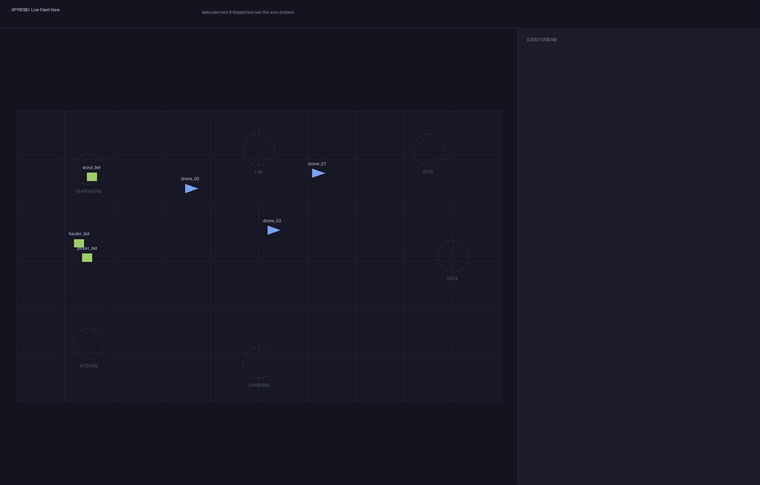

# Demo: Live Fleet View

A browser canvas showing a mixed fleet — 3 drones + 3 ground robots —
moving in real time while an APYROBO orchestration server plans and
dispatches their tasks. Everything you see travels over the standard
[wire protocol](../../spec/wire-protocol.md), rendered by the
[reference TypeScript client](../../packages/apyrobo-client-ts).



Drones (triangles) and ground robots (squares) move across a top-down world
with named zones, motion trails, and dashed lines to their current targets;
a side panel streams the planner's responses and lets you dispatch your own
tasks. The GIF above is rendered headlessly from the demo's real sim and
planner (`./record.sh`); run it live (below) for the interactive version.

## What it demonstrates

- **Real rendering**, not a terminal log: robots move on a top-down world
  with trails and target lines; drones are triangles, ground robots are
  squares.
- **Natural language → skills → motion.** Type "deliver from the
  warehouse (15, 12) to the dock (90, 30)" and the planner returns a real
  multi-step plan (`Navigate To → Pick Object → Navigate To → Place
  Object`); the robot then drives to the dock. The demo uses the rule
  planner, which reads coordinates, not place names: the zone names on the
  map are labels, so give their coordinates.
- **Refusals move nothing.** A task the planner cannot plan as asked
  ("patrol the perimeter", "deliver a package to the dock") is refused with
  the reason, shown as REFUSED in the side panel, and no robot moves. It is
  the same check `apyrobo mcp` and `apyrobo serve` apply; the reason rides
  in `metadata.execution`, as `apyrobo serve --execute` reports it.
- **Coordination.** An auto-dispatcher keeps idle robots busy by submitting
  tasks through the same `receive → plan → respond` loop a human client
  uses; you can interleave your own tasks from the panel at any time.
- **Protocol forward-compatibility, live.** Robot positions stream as
  `status: "telemetry"` messages — an *extension* status. The spec says
  1.0 clients MUST ignore statuses they don't recognize, and the reference
  client does exactly that (telemetry drives the canvas; only
  `planned`/`error` resolve a task). So this page is also a running test of
  the rule that lets the protocol evolve without breaking clients.

## Run it

```bash
pip install -e '.[websocket]'                    # from the repo root
npm --prefix packages/apyrobo-client-ts install
npm --prefix packages/apyrobo-client-ts run build
python demos/fleet_view/server.py
# → open http://localhost:8420/demos/fleet_view/index.html
```

`./record.sh` does the build + launch and prints the URL.

## How it's wired

```
 index.html ──ApyroboClient (ws://…)──►  WebSocketOrchestrationAdapter
   canvas   ◄──── telemetry (10 Hz) ────┐         │
                                        │    FleetViewServer.plan()  ← Agent
   task box ──── submitTask() ──────────┘         │
                                          assigns movement target → sim tick (20 Hz)
```

`server.py` subclasses `OrchestrationServer`: it plans through the normal
APYROBO pipeline, then *acts the plan out* by giving the addressed robot a
target derived from the task text (its last `(x, y)`, or a named zone for
a planner that reads names). A refused plan, or one that does not drive
(`report status`), leaves the robot where it is; there is no random
waypoint. Swap the kinematic sim for real adapters and the same page
drives real hardware.
